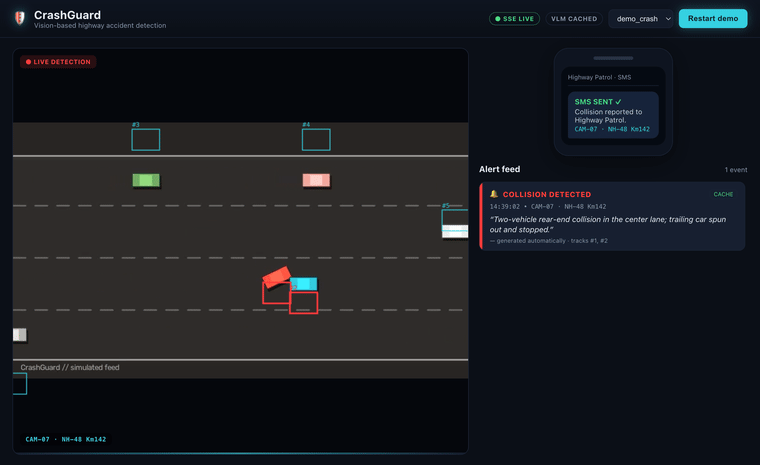

# CrashGuard 🛡

Vision-based highway accident detection. Real-time footage → computer-vision
tracking → trajectory-physics crash reasoning → hosted VLM confirmation →
instant Server-Sent-Event alerts on a live dashboard with an SMS-to-Highway-Patrol
mockup.



## The pipeline (four stages, two of which "think")

```
 SEE                  REASON                 CONFIRM                ALERT
 YOLOv8n + ByteTrack   pure-NumPy physics     Anthropic vision VLM   FastAPI + SSE
 vehicles -> track     motion signature =     "real crash? one-line  red flash + card
 IDs -> trajectories   crash candidate        description"           + "SMS SENT ✓"
 (CPU, cached to JSON)  (no box-overlap        (async, off the        React dashboard
                        heuristics)            frame loop, 10s t/o)
```

## CTOL

**CTOL** — the CrashGuard Threshold Optimization Loop: an agentic,
batch-parallel, self-tuning loop that optimizes the physics thresholds against
labeled clips to maximize F1 (LLM proposer + heuristic fallback, speculative
pre-evaluation, plateau→human escalation). *"Our physics layer wasn't
hand-tuned — it optimized itself against labeled footage."*

It ships with a **real-dataset ingestion layer** (`ctol/ingest.py` +
`ctol/contact_sheet.py`) that turns HWID12 / CADP / your own footage into the
cached-trajectory JSON CTOL trains on — so the self-tuning claim runs on real
labeled data, not just synthetic clips. `make ingest` / `make verify`; full
workflow in [`ctol/README.md`](ctol/README.md).

## Hard constraints — all satisfied

- **No local GPU in the critical path.** YOLOv8n runs on CPU; CUDA is used only
  if present. The VLM is a hosted API call, never a local model.
- **VLM never runs in the frame loop.** Candidates are handed to a background
  asyncio task; the frame loop keeps running (proven: a mocked 3 s VLM leaves
  per-frame time unchanged — `tests/test_stream.py`).
- **No single point of failure.** VLM unreachable → event still ships marked
  `unconfirmed — physics-only detection`. ByteTrack fails → greedy IoU (0.3)
  frame-to-frame matching. LLM proposer fails → heuristic coordinate descent.
- **Track once, tune many.** Tracking is cached to JSON; CTOL and every replay
  consume cached trajectories and never re-run YOLO.
- **One source of truth.** Every threshold / model name / path / color lives in
  `config.py`. Data contracts are frozen/dataclasses. Python 3.11+, typed.

## Repo layout

```
config.py             # single source of truth: Config dataclass + all constants
pipeline/
  track.py            # SEE:     video -> cached trajectory JSON (ByteTrack | IoU)
  physics.py          # REASON:  CrashDetector + run_detector() (pure function)
  vlm.py              # CONFIRM: async confirm() -> Confirmation (degrades safely)
  stream.py           # wiring:  process_stream see->reason->confirm, outbound queue
  simulate.py         # renders the self-consistent demo crash clip + tracks
  precache.py         # pre-computes VLM confirmations for demo clips
ctol/
  evaluator.py        # deterministic F1 over LabeledClips (the un-foolable reward)
  optimizer.py        # LLMProposer (claude-sonnet-4-6) + HeuristicProposer fallback
  logger.py           # JSONL trace + convergence PNG (dark theme)
  ctol.py             # the loop: batch-parallel, speculative, plateau escalation
  ingest.py           # real datasets (HWID12/CADP/own) -> cached-trajectory JSON
  contact_sheet.py    # frame grids for fast manual crash-span labeling
server/main.py        # ALERT: FastAPI /events (SSE) + /status + /demo/start
web/                  # React (Vite) dashboard
data/{clips,datasets,tracks,labels,vlm_cache}/
tests/                # pytest per phase — the verification oracle
```

## Quickstart

```bash
make install          # pip + npm deps  (justified in requirements.txt)
make test             # all phases green
make demo             # build web, start server, open dashboard, queue clip #1
```

`ANTHROPIC_API_KEY` is optional — copy `.env.example` to `.env` and fill it in to
enable the live LLM proposer and live VLM confirmation. Everything runs and
demos without it (heuristic proposer, pre-cached confirmations, degradation).

## Run / verify each stage

| Stage | Run | Verify |
|---|---|---|
| SEE | `make track` | JSON loads; ≥1 track persists ≥30 frames; stable IDs |
| REASON | `pytest tests/test_physics.py` | rear-end fires 1× ±15f; braker/swerver/cluster silent |
| CTOL | `make ctol` | F1 climbs ≥0.2; terminates with a reason; `docs/ctol_convergence.png` |
| CONFIRM | `pytest tests/test_stream.py` | 3 s VLM never stalls the loop; queue receives it |
| ALERT | `make demo` | alert card + description; kill key → card marked *unconfirmed* |

## Demo

Four cached clips are registered in `config.DEMO_CLIPS` (pick from the dashboard
dropdown):

- **`demo_crash`** — a rendered top-down CCTV simulation whose pixels match its
  tracks exactly, so it produces a guaranteed, self-consistent detected crash
  (VLM confirmation pre-cached in `data/vlm_cache/` — zero live-API risk).
- **`highway` / `highway_wide`** — real, CC-licensed, genuine 30fps footage
  (Ayalon Freeway, Tel Aviv, from Wikimedia Commons — real-time, not a
  time-compressed stock clip). Live YOLOv8 + ByteTrack tracking on genuine
  traffic. They carry a stricter **per-camera config** (`HIGHWAY_STRICT_CONFIG`)
  so normal merging/slowing at an interchange never false-alarms — the kind of
  per-deployment calibration CTOL produces.
- **`junction`** — **a real low-speed collision on fixed-camera CCTV**: a car
  strikes the vehicle ahead and stops askew, halting traffic (~5.9s, verified
  against the burned-in camera clock). Physics fires once on the approaching
  car's trajectory collapse in an otherwise congested scene; confirmation
  pre-cached. Each demo clip may specify its own `config` and `playback_rate`;
  the dashboard also has a live speed control.

The **live path** (real YOLO → physics → VLM) stays available for judge-supplied
footage. `make precache` regenerates real VLM confirmations for non-simulated
clips when a key is present.

Backup captures: `docs/crashguard_demo.gif`, `docs/dashboard_working.png`,
`docs/dashboard_unconfirmed.png`.
```
